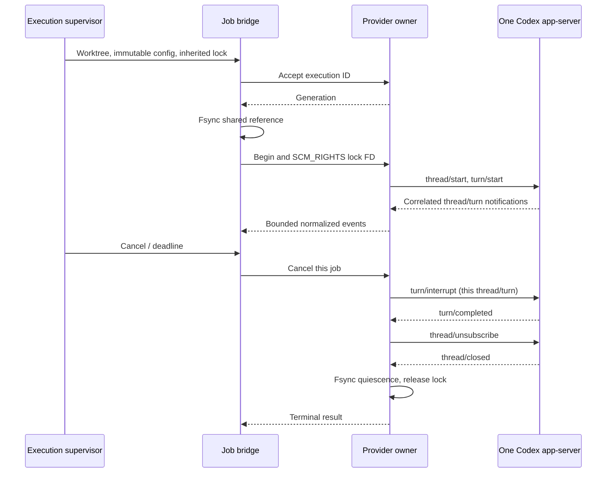

# Persistent profiles and shared Codex execution

Implemented locally on October 11, 2026; native model acceptance is pending. This stays within runtime-worker. See [ADR 006](../../../docs/adr/006-provider-profile-ownership.md) and [identity findings](../../../docs/provider-identity.md).

## Operator profiles and migration

`serve --codex-home <directory> --claude-config-dir <directory>` selects existing operator profiles. Explicit directories must be canonical Linux paths below the current user's home, mode 0700, separate from worktrees and `/mnt/c`. Without a selector, stable Linux HOME remains the default. The worker never creates credentials, reads their contents, logs in per job, generates tokens, copies Windows auth or grants access. A new UID still needs separately approved operator provisioning.

Claude uses its supported persistent CLI profile across jobs. `setup-token` remains an optional human-managed alternative; the worker does not generate or inject it. Agent environment allowlists still reject auth variables/profile selectors. Native Claude execution and parallel refresh behavior remain unverified.

The compatible Codex default is `--codex-backend subprocess`. After the account/profile/deployment scopes are approved, stop new dispatch and drain current jobs, start one provider owner, then run the existing consumer with the shared selector:

```bash
# Paths refer to existing provisioned profiles/tools; never secret values.
adf-worker provider-server --root "$ADF_WORKER_ROOT" \
  --node "$ADF_NODE_PATH" --codex "$ADF_CODEX_PATH" --codex-home "$ADF_CODEX_HOME"

# Separate consumer process/service, with its existing private token files.
adf-worker serve --root "$ADF_WORKER_ROOT" --codex-backend shared \
  --node "$ADF_NODE_PATH" --claude "$ADF_CLAUDE_PATH" \
  --claude-config-dir "$ADF_CLAUDE_CONFIG_DIR" \
  --token-file "$ADF_WORKER_TOKEN_FILE" --redis-password-file "$ADF_REDIS_PASSWORD_FILE"
```

These instructions were not executed against the deployed services. No new login is requested. Rollback drains shared jobs, stops the provider owner and switches the consumer to `subprocess`. Do not run Codex subprocess jobs or other rotating-auth clients against the shared profile concurrently. Legacy tickets default to the original backend; new tickets snapshot trusted backend/profile paths. API/Redis/workflow contracts are unchanged.

Shared startup verifies Codex **0.157.0** / Node **24.21.0** and requires an explicit clean profile without `config.toml`, rules, skills, AGENTS or environment layers. Worktree ancestry containing another `.codex` directory is refused. Pinned app-server has no exec `--ignore-user-config` / `--ignore-rules`; refusing these layers avoids claiming equivalent switches. Administrator requirements may further restrict execution. The worker never changes an existing profile to satisfy this rule.

## Boundaries and protocol

One operator process owns one stdio app-server and its shared AuthManager. Its runtime directory is 0700; its Unix socket is 0600 and admits only same-UID clients. No TCP/auth broker is added. A provider lock prevents a second owner for this runtime root; it is not a cross-root/machine credential lock. Operators must keep one root/authority per profile.

Each existing detached supervisor launches an isolated Python bridge. Jobs have separate native thread/turn IDs, canonical allocated ext4 worktrees, models, sandboxes, approved skill selectors, exact owned MCP launchers and response schemas. Bridge frames cannot broaden baseline permissions/disabled features/network policy. Arbitrary RPCs and server-initiated approval/auth operations are denied. The server receives a fixed sanitized operator environment; per-job overrides are explicitly unsupported. Private API/Redis credentials are not forwarded.

The bridge fsyncs a generation/reference before allowing thread dispatch, then transfers the **same execution-lock inode** through SCM_RIGHTS. The provider holds that descriptor until quiescence. Bounds: three jobs, eight connections, 32 pending RPCs, 128 queued notifications per thread and 512 KiB per frame. Provider stderr is discarded/capped. Broker journals store IDs/paths/state, never prompts, wire payloads or raw errors. Only normalized approved output/tool metadata and token counts enter the existing redacted pipeline; private reasoning/tool arguments are omitted.

The legacy orchestrator's exact `env_allowlist` sequence `["PATH", "HOME", "LANG", "TERM"]` is accepted as a compatibility marker and normalized to an empty per-job list before probing/materialization/bridge execution. It carries names only, never values; the owner keeps its fixed sanitized operator HOME/PATH and explicit private profile. Empty lists remain supported. Subsets, reordered/duplicate/extended lists, profile selectors, secret names and value-like entries are refused before probing or dispatch. No environment field is added to the broker protocol. A captured actual queue envelope plus an umbrella source-hash/AST contract binds this exception to orchestrator `6fe7c14`; offline wire tests prove the owner's environment remains unchanged and secret variables are absent. Native queued acceptance is a separate gate.



## Quiescence and recovery

The pin supports `turn/interrupt` / `thread/unsubscribe`, **not** `thread/unload`. An unsubscribe response is not a shutdown proof. With fixed `thread_unload_delay_secs=0`, ADF waits for `thread/closed`, emitted by the pinned lifecycle only after successful `shutdown_and_wait`. Routine job cancellation does not terminate siblings or the shared server. Existing OS session proof covers the supervisor/bridge; an additional shared journal proves logical thread closure. It does not claim separate per-thread OS SIDs or native MCP descendant PID evidence.

Missing closure yields `uncertain`, retains the execution lock and preserves skill/config materialization. No commit, worktree cleanup or ACK may follow an unproven writer. A later operator stop with verified whole-server SID death establishes quiescence while retaining the uncertain outcome. Residual launch files/skills require guarded reconciliation; restart does not silently delete or stage them.

An app-server crash fails in-flight jobs without replay. Startup requires old-owner death proof and stops only the recorded server SID using checked pidfds before accepting new work. Missing/recycled ownership and a spawn gap fail closed. Durable accepted-ID tombstones survive generations: an ID can never be dispatched again. Explicit ledger retries use a new execution ID after the normal stopped-proof fence. No provider resume is implemented; lost terminal transport is reconciled from journals.

Missing/expired auth returns `AUTH_REQUIRED`; native `unauthorized` blocks subsequent dispatch in that generation. No login, token regeneration, model/provider/billing fallback or raw auth error is attempted. Operator recovery uses an approved secure provisioning channel and restarts the sole authority.

## Evidence and remaining gates

Offline tests use real subprocesses, Unix sockets, SCM_RIGHTS and flocks. Cases cover three jobs with distinct cwd/model/skills/MCP; cancellation of one; absent closure with retained files/lock; crash/new generation without ID replay; orphan-server cleanup; missing/expired/revoked auth; redaction; and environment refusal. Generated thread/turn/interrupt/unsubscribe/closed messages validate against five vendored public schemas with full-source SHA-256 and pinned tag tree.

The installed native 0.157.0 binary passed **initialize + account/read** with an empty temporary profile and baseline strict config. It had no account, **zero thread/model calls**, no existing credential contents read, and verified dedicated-SID shutdown. This proves launch/handshake, not model execution or native skill/MCP/descendant cleanup.

Production adoption still requires separately authorized native three-session capability/cancel/crash acceptance under the intended minimally privileged UID/profile. Shared refresh serialization is supported by pinned source inspection; tests do not force real token rotation. Same-UID trusted code can access its host account: this is not a hostile-code secret sandbox or Windows/WSL credential bridge. MVP readiness remains false.
